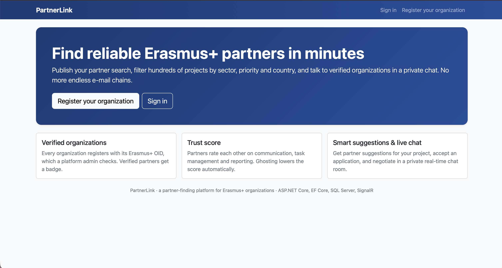
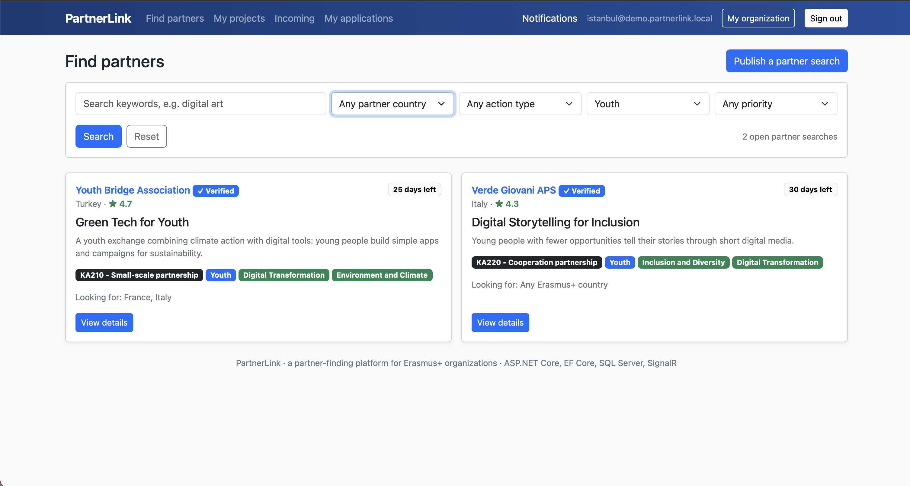
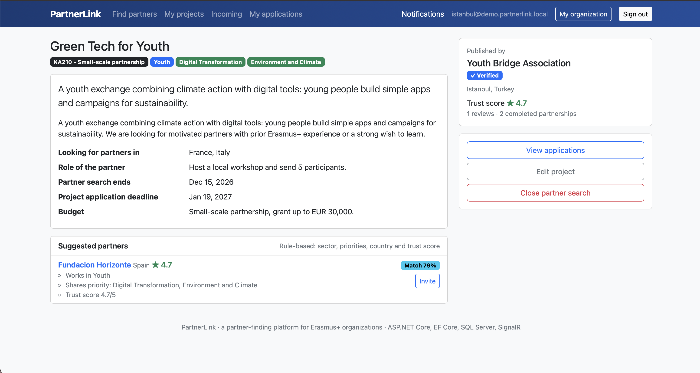
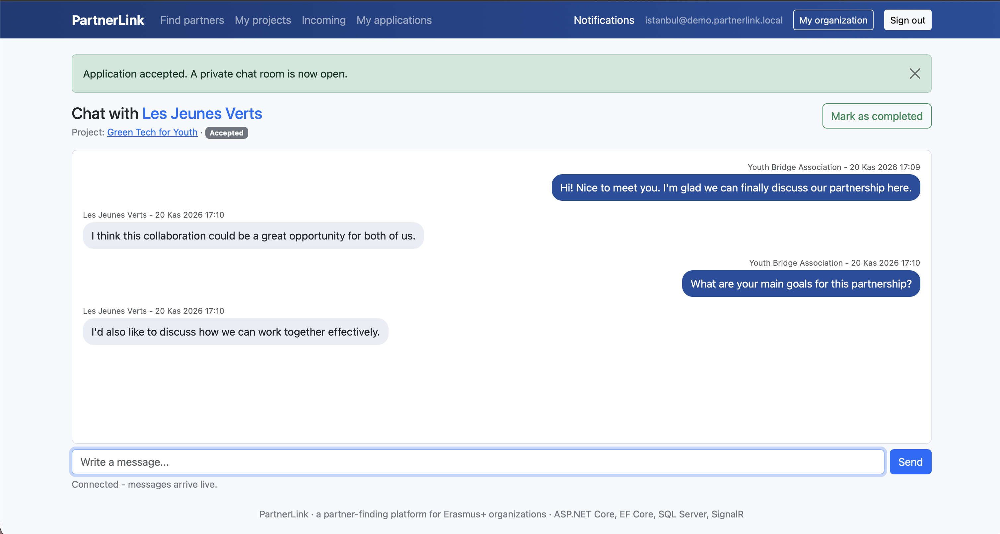
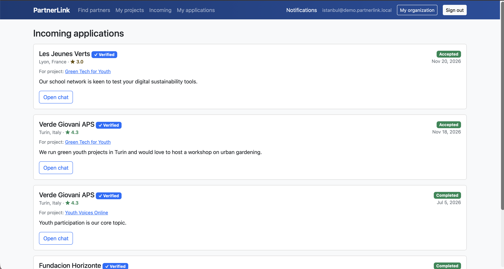
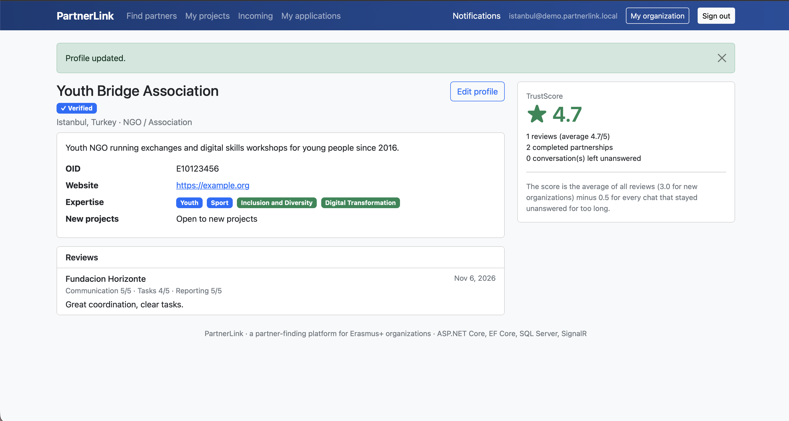

# PartnerLink

A partner-finding platform for Erasmus+ organizations, built with **.NET 10**, **ASP.NET Core MVC**, **SignalR**, **EF Core** and **SQL Server 2022**.

Organizations register with their OID code, get verified by an admin, publish project ideas, find partners through a filtered feed, apply, chat in real time, and build a trust score through reviews.

## Screenshots



| Project feed with filters | Project owner view with suggested partners |
|---|---|
|  |  |

| Real-time chat (SignalR) | Incoming applications |
|---|---|
|  |  |



## Run it

```bash
docker compose up --build
```

Open <http://localhost:8091>. The database is created and seeded with demo data on first start.

| Account | Password | Role |
|---|---|---|
| `admin@partnerlink.local` | `Admin123!` | Admin (verifies organizations) |
| `istanbul@demo.partnerlink.local` | `Demo123!` | Verified organization |
| `turin@demo.partnerlink.local` | `Demo123!` | Verified organization |
| `valencia@demo.partnerlink.local` | `Demo123!` | Verified organization |
| `lyon@demo.partnerlink.local` | `Demo123!` | Verified organization |
| `nordic@demo.partnerlink.local` | `Demo123!` | Pending verification |

Tip: open two browsers (or one normal and one private window), sign in as `istanbul@` and `turin@`, and chat in the accepted partnership to see SignalR in action.

### Without Docker for the web app

```bash
docker compose up -d db
dotnet run --project src/PartnerLink.Web
dotnet test
```

## Features

- **Registration and verification**: OID format check (`E` + 8 digits), unique per organization, admin approves or rejects. Only verified organizations can publish or apply.
- **Project feed**: filter by sector, priority, action type (KA1 / KA210 / KA220), target country and keyword; paged.
- **Applications**: apply with a message, owner accepts or rejects, either side can mark a partnership as completed.
- **Real-time chat** (SignalR): available only for accepted partnerships; messages persisted, read receipts, one unread notification per conversation.
- **Reviews and trust score**: after completion both sides rate communication, reliability and quality (1-5).
- **Ghosting detection**: a background service flags accepted conversations where one side has been silent for N days and lowers that organization's trust score.
- **Partner suggestions**: rule-based scoring of verified organizations per project (sector 35, priorities 25, country 20, trust 20).
- **Notifications** with an unread badge.

## Design decisions

- **Layers**: `Core` (entities, enums, contracts, pure scoring) -> `Infrastructure` (EF Core, services, background worker, seeding) -> `Web` (MVC, SignalR, Identity). Core has no framework dependencies.
- **Authorization lives in the services**, by organization id, so rules hold no matter which controller or hub calls them.
- **Flags enums** (`Sector`, `Priority`) are stored as integers and filtered with bitwise SQL via `HasFlag`.
- **Trust score** = average review (3.00 for new organizations) - 0.5 per ghosted conversation, clamped to 0-5. The formula is a pure function and unit-tested.
- **Database integrity**: unique indexes (OID, one application per project and organization, one review per side), check constraints on review scores, restrictive foreign keys.
- **Time** is injected through `TimeProvider`, so ghosting logic is tested with a fake clock.
- **Tests**: xUnit with EF Core InMemory covering services, filtering, scoring, chat access and ghosting.
- `Database:AutoInitialize` applies migrations when they exist and falls back to `EnsureCreated` otherwise. To use migrations:
  ```bash
  dotnet ef migrations add Initial -p src/PartnerLink.Infrastructure -s src/PartnerLink.Web
  ```

## Possible next steps

PIF PDF generation, AI-assisted text matching, installable PWA, email notifications.
